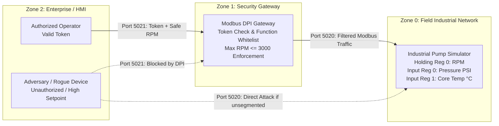

# ICS / SCADA Modbus TCP Attack & Defense Lab

[](https://github.com/Bassma202/scada-modbus-defense-lab/actions)
[](https://opensource.org/licenses/MIT)
[](https://www.python.org/)
[](https://www.isa.org/standards-and-publications/isa-standards/isa-iec-62443-series)

> **Simulated Industrial Control System (ICS) environment demonstrating physical process manipulation (Modbus over-speed sabotage) and defensive mitigation via a Zero-Trust Deep Packet Inspection (DPI) Security Gateway.**

---

## 1. Executive Summary & Architecture

Modbus TCP is the foundational protocol of industrial automation, but inherently lacks authentication, authorization, and message integrity. In an unsegmented operational technology (OT) network, any rogue device can issue command messages directly to programmable logic controllers (PLCs).

This repository implements:
1. **Industrial Water Pump Simulator (Slave):** Emulates variable frequency drive physics (RPM, water pressure in PSI, motor core temperature in °C).
2. **Zero-Trust Security Gateway (Proxy/Firewall):** Intercepts ingress Modbus traffic, enforces token-based role authentication, and runs Deep Packet Inspection (DPI) to block hazardous parameter setpoints.
3. **Adversary Attack Suite:** Demonstrates direct command injection, over-speed sabotage (Stuxnet-style physical damage), and privilege escalation.
4. **Traffic Analysis & Telemetry:** Wireshark display filters and packet signatures for SOC/OT incident response.



---

## 2. Threat Model & MITRE ATT&CK for ICS Mapping

| Technique ID | Technique Name | Attack Scenario | Gateway Mitigation |
| :--- | :--- | :--- | :--- |
| **T0855** | Unauthorized Command Message | Attacker transmits arbitrary `0x06` write single register commands. | Gateway requires cryptographically signed token before accepting any Modbus PDU. |
| **T0831** | Manipulation of Control | Attacker injects 5,000 RPM into speed register, exceeding mechanical tolerance. | DPI inspection strictly enforces max threshold ($\le 3000\text{ RPM}$). |
| **T0885** | Common Industrial Protocol Manipulation | Attacker issues unauthorized coil forced trips (`0x05`) to shut down pump. | Role-Based Access Control (RBAC) verifies caller permission before forwarding write PDUs. |

---

## 3. Register Mapping & Telemetry Specs

* **Coil 0 (Address 0x0000):** Pump Motor State (`0x0000` = OFF, `0xFF00` = ON).
* **Holding Register 0 (Address 0x0000):** Commanded Pump Speed in RPM ($0 - 3000\text{ RPM}$). Nominal operating baseline is $1450\text{ RPM}$.
* **Input Register 0 (Address 0x0000):** System Hydraulic Pressure ($0 - 150\text{ PSI}$). Automatically calculated based on RPM.
* **Input Register 1 (Address 0x0001):** Motor Core Temperature ($20 - 120^\circ\text{C}$). Overheating triggered if continuous operation exceeds $2800\text{ RPM}$.

---

## 4. Quickstart & Execution

### Prerequisites
* Python 3.10+ (or Docker & Docker Compose)
* Wireshark / TShark (optional for PCAP inspection)

### Run with Docker Compose
```bash
# Clone the repository
git clone https://github.com/Bassma202/scada-modbus-defense-lab.git
cd scada-modbus-defense-lab

# Start the isolated industrial network
docker-compose up -d

# Verify containers are running
docker-compose ps
```

### Run Locally (Step-by-Step)
```bash
# Terminal 1: Start the Pump Simulator (Port 5020)
python3 src/pump_simulator.py

# Terminal 2: Start the Security Gateway (Port 5021)
python3 src/security_gateway.py

# Terminal 3: Execute the Authorized Operator Workflow
python3 src/operator_client.py

# Terminal 4: Launch the Adversary Attack Demonstration
python3 src/adversary_attack.py
```

### Running Automated Test Suite
```bash
python3 -m unittest discover tests
```

---

## 5. Lab Results & Verification

### Scenario A: Unprotected Pump Direct Attack
When port `5020` is directly reachable by an attacker:
```text
[ATTACKER] Sending malicious Modbus write packet: Setting Pump Speed = 4500 RPM...
[PUMP] [ALERT] Holding Register 0 modified! New Speed: 4500 RPM
[PUMP] [DANGER] PUMP OVERSPEED: 4500 RPM exceeds safety threshold (3000 RPM)!
>>> EXPLOIT SUCCESSFUL: Unprotected pump accepted rogue 4500 RPM command!
```

### Scenario B: Gateway DPI Defense
When the adversary routes malicious commands through the Security Gateway (Port `5021`):
```text
[ATTACKER] Sending 5000 RPM Over-speed payload through Gateway...
[GATEWAY] [DPI BLOCKED] Client 127.0.0.1 | Reason: SAFETY_POLICY_VIOLATION: Requested 5000 RPM exceeds safety threshold (2800 RPM)
>>> DEFENSE VERIFIED: Gateway Deep Packet Inspection intercepted hazardous payload! Exception 0x04
```

---

## 6. Author & Academic Context

* **Author:** **Bassma Alaoui Sossey**  
* **Degree:** Diplôme d'Ingénieur d'État en Cybersécurité (State Engineering Degree in Cybersecurity)  
* **Institution:** Université Euromed de Fès (UEMF), Morocco  
* **Specialization:** Industrial & Critical Infrastructure Cybersecurity (ICS/SCADA), Network Security, DFIR
